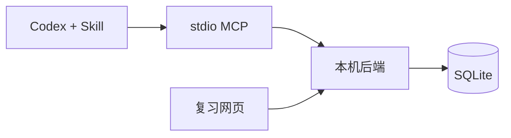

# 架构与开发

当前 Codex 生成语言解释和卡片内容；本机后端只负责保存与复习，不调用额外模型。



| 模块 | 职责 |
| --- | --- |
| Skill | 按读写场景提供帮助，选取值得保存的片段。 |
| MCP | 提供 `capture_learning`，先写本地队列，再提交后端；失败后补传。 |
| 后端 | Fastify + `node:sqlite`，处理保存、查询、幂等和复习日期。 |
| 网页 | React + Vite，记录列表、详情和回忆卡片；构建后由后端提供。 |

## 运行与数据

每个聊天可有独立 MCP 进程，共用一个监听 `127.0.0.1:47831` 的后端。启动器核对服务标识、协议和数据目录；匹配时复用，未运行时后台启动，冲突时报告错误。

源码与个人数据分开。默认数据目录 `%LOCALAPPDATA%\CodexEnglishCoach` 保存 SQLite、日志、安装记录和待发送队列。默认卸载保留这些数据。

记录用稳定请求编号防止重试重复写入；卡片另按方向、类型、表达和义项去重。卡片、遇见记录和复习事件分别保存。`saved` 表示后端已确认，`queued` 仅表示本地队列已持久保存。

接口以 [共享契约](../packages/shared/src/index.ts) 为准；工具字段与触发规则见 [Skill](../skills/codex-english-coach/SKILL.md)，调度见 [复习规则](learning.md)。

## 开发检查

需要 Node.js 24.x 和 npm。在仓库根目录运行：

```powershell
npm ci
npm run check
node scripts/validate-skill.mjs
npx playwright install chromium
npm run test:browser
```

`check` 执行类型检查、构建和测试；浏览器检查单独运行。Windows CI 使用同样的入口；其实际结果以工作流记录为准。
